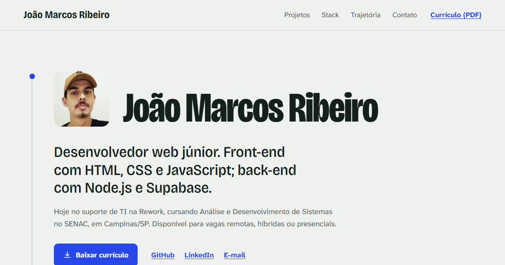

# Portfólio · João Marcos Ribeiro

Meu portfólio pessoal: projetos, stack, trajetória e contato. Desenvolvedor web júnior, com front-end em HTML, CSS e JavaScript e back-end em Node.js e Supabase.

**Site:** https://joaomarcos-jhn.github.io/portfolio/



## Sobre o site

Os projetos aparecem como um changelog. O que ainda está em desenvolvimento vem primeiro, e depois cada entrega, da mais nova para a primeira. Uma linha vertical atravessa a página e liga cada versão até o contato.

- HTML semântico, CSS e JavaScript puros, sem framework e sem etapa de build
- Responsivo, com modo claro e escuro (segue a preferência do sistema)
- Acessível: link para pular ao conteúdo, foco visível no teclado, textos alternativos e respeito a `prefers-reduced-motion`
- Galeria com `<dialog>` nativo, navegável pelas setas do teclado
- Imagens em WebP, com miniaturas e carregamento sob demanda

## Estrutura

```
index.html
css/style.css        tokens de cor e tipografia no topo do arquivo
js/main.js           galeria, botão de copiar e-mail, ano do rodapé
assets/
  curriculo-joao-marcos-ribeiro.pdf
  img/               fotos, prints dos projetos e imagem de preview (og.png)
```

## Rodar localmente

Não precisa instalar nada. Basta abrir o `index.html` no navegador ou subir um servidor estático:

```bash
python -m http.server 8000
# acesse http://localhost:8000
```

## Contato

- E-mail: joaomarcosr.contato@gmail.com
- LinkedIn: [in/joão-marcos-ribeiro](https://www.linkedin.com/in/jo%C3%A3o-marcos-ribeiro-088580347/)
